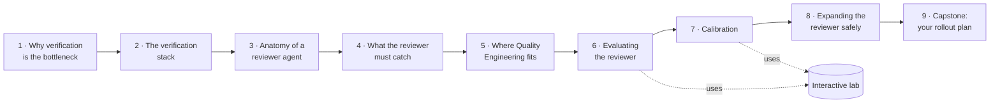

# AI Reviewer Agents: A Self-Paced Course

How to design, operate, calibrate and grow an AI code reviewer agent, and where Quality Engineering fits, for teams that generate most of their code with AI.

The anchor source is Anthropic's post [*How the Claude Code team thinks about verification*](https://claude.dev/blog/how-the-claude-code-team-thinks-about-verification) (Addy Osmani, Nov 2026). It is extended with the companion post [*How the Claude Code team does code review*](https://claude.dev/blog/solving-code-review-at-anthropic/) (Oct 2026), the [Code Review docs](https://code.claude.com/docs/en/code-review), and outside research on LLM-judge calibration and AI review benchmarks. The full list is in [SOURCES.md](SOURCES.md).

## How to use this

- Each module takes **20–40 minutes**. They are written to be read one per sitting.
- Every module ends with **exercises**. Answers are hidden in collapsible `
` blocks, so try the exercise before you open them.
- Diagrams are **Mermaid**. They render on GitHub, in VS Code (with the Markdown Preview Mermaid extension) and in Obsidian.
- Modules 4, 6 and 7 use the **interactive lab**. The hosted version is at [claude.ai/artifact/1q9sCyqBBEcubuNwks5QwP](https://claude.ai/artifact/1q9sCyqBBEcubuNwks5QwP) and the source is [`lab/reviewer-lab.html`](lab/reviewer-lab.html). It has three tabs: threshold tuning, severity triage and agreement (κ). Open a tab directly with `#tuner`, `#triage` or `#agreement`.

## Learning path

| # | Module | You will be able to… | Time |
|---|---|---|---|
| 1 | [Why verification is the bottleneck](modules/01-why-verification.md) | Explain why verification, not generation, caps how much you can delegate to AI | 20m |
| 2 | [The verification stack](modules/02-verification-stack.md) | Place the reviewer agent among tests, `verify` skills, CI and humans | 30m |
| 3 | [Anatomy of a reviewer agent](modules/03-reviewer-anatomy.md) | Sketch the Find → Verify → Rank → Post pipeline and its integrity rules | 40m |
| 4 | [What the reviewer must catch](modules/04-reviewer-concerns.md) | List the concerns a reviewer covers, including AI-specific failure modes, and what it should ignore | 30m |
| 5 | [Where Quality Engineering fits](modules/05-quality-engineering.md) | Define QE's job when agents write the code and review it | 30m |
| 6 | [Evaluating the reviewer](modules/06-evaluation.md) | Build an eval set, score recall per stage, measure noise | 40m |
| 7 | [Calibration](modules/07-calibration.md) | Tune thresholds and severity, measure judge–human agreement, move from observe to enforce | 40m |
| 8 | [Expanding the reviewer safely](modules/08-expanding-the-reviewer.md) | Add rules and capabilities without regressions, and prune what no longer pays | 30m |
| 9 | [Capstone: your rollout plan](modules/09-capstone.md) | Produce a 90-day plan, scorecard and REVIEW.md for your own team | 60m |

## The one-sentence version

> The human job "shifts from reading every diff to defining what 'done' looks like and reviewing the evidence."  (from the anchor post)

The reviewer agent is one part of that evidence. Quality Engineering makes sure the evidence can be trusted.
