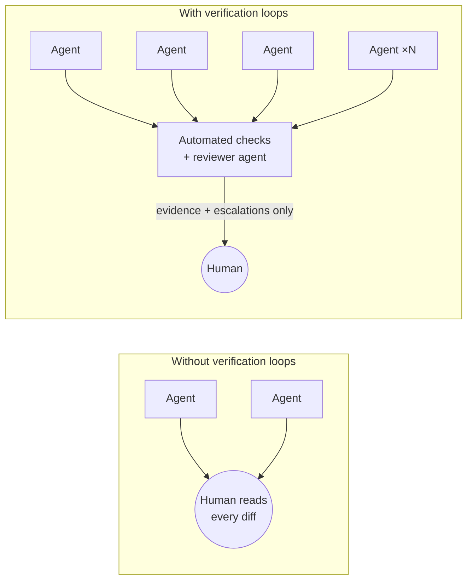
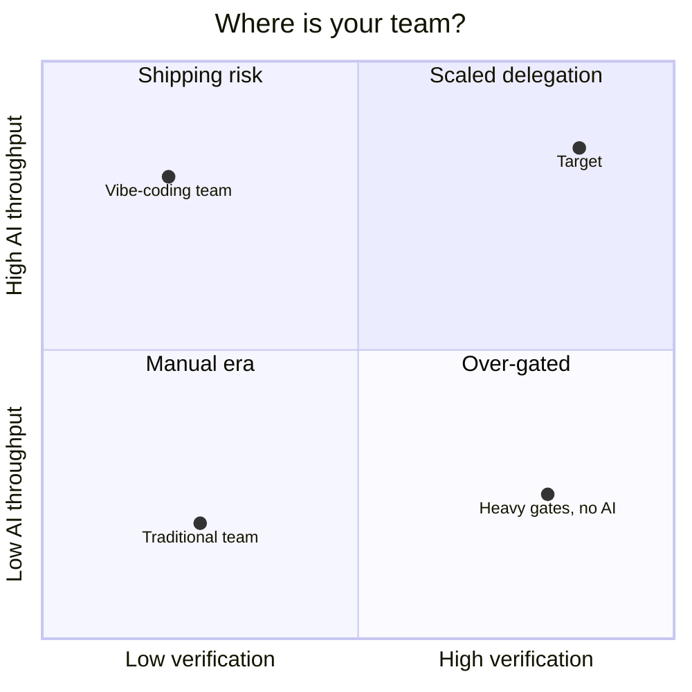

# Module 1: Why verification is the bottleneck

**Time:** ~20 min · **Next:** [Module 2: The verification stack](02-verification-stack.md)

## The big idea

When AI writes the code, **how much you can delegate is capped by how much you can verify.**

The anchor post states it directly. Without verification loops, a person has to check everything, so only one or two agents can run at a time. With them, dozens or hundreds can run in parallel. On the Claude Code team, roughly **90% of code is written and reviewed by Claude**, and at that scale how agents verify their work "becomes extremely important."

The human does not leave. The human moves to a different place in the loop.

## Three shifts to internalise

### 1. Checks became cheap to write

Tests, benchmarks, specs and end-to-end harnesses used to be expensive to write, so teams rationed them. Agents now write them cheaply. Once written, they run as ordinary software: many times, at little token cost. A team that still rations tests the old way is under-investing.

### 2. The bottleneck moved from writing to reviewing

Outside data points the same way, though treat these vendor and survey figures as directional:

- A Qodo survey found **reviewing and validating AI code** was the top delivery constraint for developers and engineering leaders alike, and only **3.7%** of leaders said their processes were sufficient.
- Faros AI data, cited second-hand by Entrepreneur, reported **review time up 91%** on high-AI-adoption teams with flat headcount.

Hiring more reviewers does not close this gap, because generation scales and people don't.

### 3. The human role changes

> The human job "shifts from reading every diff to defining what 'done' looks like and reviewing the evidence."

| Old human job | New human job |
|---|---|
| Read every line | Define "done": specs, feature maps, invariants |
| Spot bugs by eye | Own the checks that spot bugs |
| Approve PRs | Approve **evidence**: test output, screenshots, findings, risk tier |
| Fix flaky tests | Decide which failures need a person |

## The guardrail metric

The companion post gives the team's goal: optimise "for the **minimum amount of human review time** that doesn't raise reverts or incidents."

That sentence has two parts, and you need both:

1. **The objective:** less human review time, measured as approvals per PR, comments, and time spent waiting on a person.
2. **The guardrail:** revert and incident rates must not rise. If they do, the team has "only moved" the human time rather than saved it.

Their reported result: merged PRs to the Claude Code codebase **more than doubled** from June to September 2026, while the share of PRs reverted **fell by more than 40%**.

## A second view: the "software factory"

The Pragmatic Engineer episode [*Software factories and code reviews*](https://newsletter.pragmaticengineer.com/p/software-factories-and-code-reviews) (Gergely Orosz with CodeRabbit CEO Harjot Gill, Nov 2026) pushes the same idea further:

- **Scale:** about **40 engineers**. Gill personally merged **5,000+ PRs in a month**, and company commits rose from a few hundred a week in July to over 5,000 a week. His own AI spend is about **$250–275K/month**, roughly **$150 per PR**. The company spends "several million dollars a month on tokens." CodeRabbit's own background agent is the **#2 committer** in the codebase. Orosz pushes back that this is an extreme outlier; for comparison, he says NVIDIA engineers have a $10K monthly budget.
- **Two ways to work with agents.** On the **"potter's wheel"**, a person shapes software one message at a time, which Gill can sustain for only one or two chats a day. In the **factory**, an agent "hill climbs" toward a goal it can check itself against. About 18 of his 20 open sessions are factory work, such as a six-week autonomous run that built a write-ahead log in Rust he has "not read a single line of."
- **Hill climbing starts from verification:** "it all starts at a very basic that agent can verify its work against something." This is the same idea as the anchor post.
- **The bottleneck moves again, this time to compute.** CI now costs "as much as tokens." A CI vendor quoted roughly **$13M/year**, so CodeRabbit built its own, which Gill expects to cost about 50% less. Then GCP ran out of CPU capacity. Developer laptops can run only three or four agent sessions before local unit tests slow them to a halt.
- **His headline:** "the human code review is dead, but the human review is not dead." People decide *whether* to ship and *how risky* a change is, at the level of a **release**, not by reading diffs (Module 4).
- **A different guardrail:** "our goal is not to prevent every outage. It's to make sure that the **exposure time** of something bad happening in production is as little as possible." Doing that requires agents watching production.

The two sources agree on the main point. Humans move from reading diffs to defining "done" and checking evidence. They differ on where the remaining human review sits (Module 4) and on what the guardrail measures:

| Guardrail | Anthropic | CodeRabbit |
|---|---|---|
| Primary | Revert and incident **rate** must not rise | Bad-code **exposure time** in prod must stay small |
| Implies investing in | Catching bugs **before** merge | Detecting and rolling back **after** merge (agents on logs and traces, 10–15 min rollback) |

Be careful with Gill's quality claim. He says the defect rate is going down, then adds "I still have to measure it." Treat that as a hypothesis, not evidence.

## Where the reviewer agent fits

The reviewer agent is **one** verification loop among several (Module 2). It is the loop that:

- reads intent and the diff together, which tests cannot do,
- applies team knowledge (REVIEW.md, the reliability checklist, past incidents) at the scale of every PR,
- decides **what needs a human** and **why**.

A reviewer agent that adds noise makes the bottleneck worse. That is why most of this course is about evaluation and calibration.

## Key takeaways

- Delegation is capped by verification capacity.
- Checks are now cheap to write. Under-investing in them is the new failure mode.
- Measure success as **less human time with no rise in reverts or incidents**. You need both halves.
- The reviewer agent's job is to make human attention go where it matters.

---

## Exercises

**1.1 Diagnose.** Your team adopted an AI coding assistant. PR count rose 60%. Median time-to-merge rose 45%. Revert rate is flat. Which quadrant are you in, and what is the bottleneck?

Answer

Throughput rose but merge latency rose with it. Generation is no longer the constraint; **review** is. You sit between "Shipping risk" and "Scaled delegation": the revert rate is flat only because humans are absorbing the load. The next step is more verification (automated loops plus a reviewer agent), not more generation.

**1.2 Metric design.** Write the objective and the guardrail for your own team in one sentence each, using metrics you can actually query today.

What a good answer looks like

- *Objective:* "Reduce median human review minutes per merged PR from X to Y." Sources: PR timeline events, review request to approval.
- *Guardrail:* "7-day revert rate and Sev2+ incidents per 100 merged PRs do not rise above their 90-day baseline."

If you can't query reverts, start by tagging them (for example, a `revert` label or commit-message convention). Every later module depends on that data.

**1.3 Reflection.** List three things you personally read in PRs today that a machine could check. List one thing only you can judge.

Hint

Machine-checkable: missing tests for a new branch, error swallowing, calls to deprecated internal APIs, breaking changes to serialised formats. Human-only usually means **should we build this at all**, architecture direction, and risk you can't express as a rule. The companion post lists these as the jobs humans keep.

