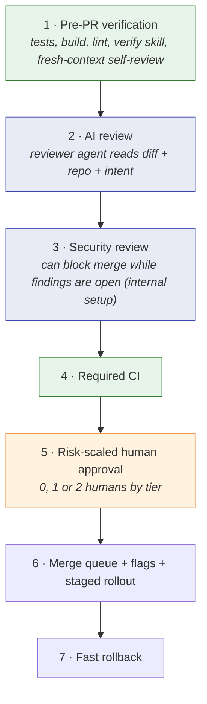
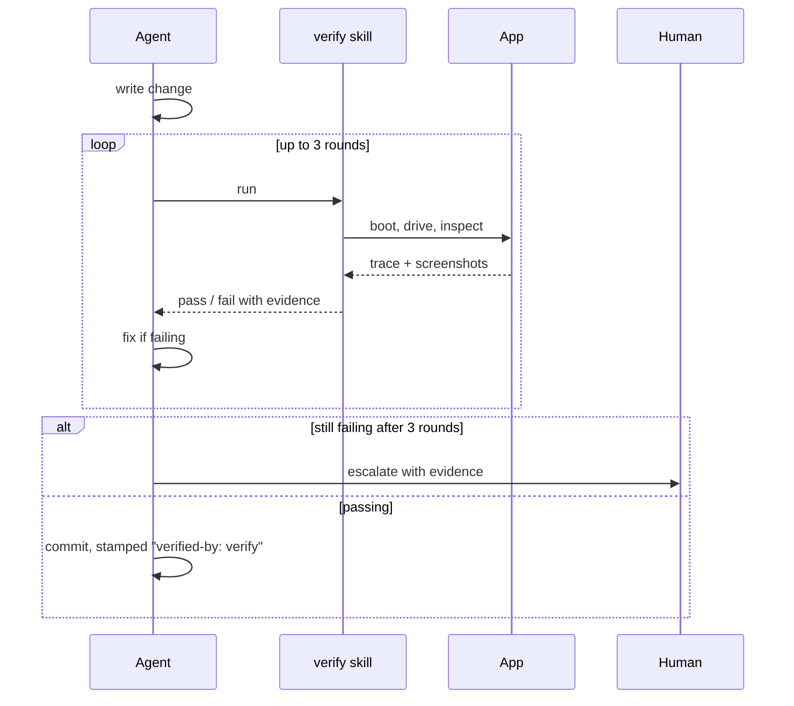

# Module 2: The verification stack

**Time:** ~30 min · **Prev:** [Module 1](01-why-verification.md) · **Next:** [Module 3: Anatomy of a reviewer agent](03-reviewer-anatomy.md)

## The big idea

A reviewer agent reads code. It does **not** run it. The Code Review docs say so plainly: reviews "do not build or run code," and "a review with no findings doesn't mean your code is error-free or secure."

So the reviewer is one layer in a stack. Each layer catches what the others can't.

## The seven layers

The companion post describes seven layers around every change:

**Rule of thumb: run cheap checks first.** Claude runs tests, build and lint *before* opening a PR. You can enforce this with a hook that runs tests when the agent finishes, or with a goal of "test suite passes."

## Layer 1 in depth: tests worth investing in

The anchor post names three kinds of test that give the most leverage when agents write code. It also names two general failure modes:

- **Flaky tests** teach the agent to rerun tests instead of fixing code.
- **Slow tests** mean fewer runs per batch, which makes failures harder to pin down.

### E2E tests (the post's first pick if you can only have one)

- They describe real user flows: add to cart → checkout → confirmation.
- They are "difficult to fool," have clear done criteria, and say *what* is broken.
- Unit tests can pass while the feature is broken, because "both the agent and the test don't understand the full task."
- Build a **feature map**: features from the user's point of view, with paths, selectors and expected results. It acts as both a guide and a grading rubric.

### Property tests: constraints that can't break

State something that must always hold, then let a library generate thousands of inputs that try to break it. Libraries: Hypothesis (Python), fast-check (JS/TS), proptest (Rust).

| Property | Example |
|---|---|
| Round-trip | `decode(encode(x)) == x` |
| Invariant | Balance never goes negative |
| Idempotency | Running a migration twice has the same effect as once |
| Equivalence | Optimised code matches naive but correct code |

**Why this matters for AI code:** property-test inputs aren't generated "with the same bias as the agent that wrote the code." The agent can't unknowingly write tests that only exercise the cases it already handles.

### Differential tests: the old system is the oracle

Run the old and new systems on the same inputs and compare. Any difference is either a bug or an intended change. Normalise irrelevant differences such as whitespace, and keep a list of approved changes. These are best for migrations and rewrites.

## Layer 1 in depth: "verification means running the change"

> "Running the app end to end matters more than tests."

The team asks Claude to test the app like a QA engineer would: the Chrome extension for web, an iOS or Android MCP for mobile, computer use for desktop, a local run for backends. They package this as a **`verify` skill** in `.claude/skills/`, placed as close to the relevant code as possible, and Claude uses it before committing. "This is how we test nearly all changes at Anthropic."

**Failing checks go to humans.** If a check still fails after three rounds, Claude stops and brings in a person. Failures are the signal for what needs human attention.

## Where the reviewer agent sits, and what it uniquely does

| Question | Tests | `verify` skill | Reviewer agent | Human |
|---|---|---|---|---|
| Does it run? | ✅ | ✅ | ❌ | – |
| Does it do what the user flow needs? | partly | ✅ | partly | ✅ |
| Does the diff match the stated intent? | ❌ | ❌ | ✅ | ✅ |
| Does it break things far from the diff, like old data or other callers? | if tested | rarely | ✅ (reads whole repo) | sometimes |
| Does it violate team rules and lessons from past incidents? | ❌ | ❌ | ✅ (REVIEW.md, checklist) | if they remember |
| Should we build this at all? | ❌ | ❌ | ❌ | ✅ |

The reviewer's niche is **reading with context at scale**: intent, the whole repo, team rules, incident history. The niche for tests and `verify` is **execution**. Don't ask a reviewer to do execution's job.

## Commit stamping and gate modes

Every commit is stamped with how it was verified, **including "none"**, so unverified commits can be queried. A commit gate can block commits from sessions that didn't run `/code-review` or `/verify`. Module 7 covers the gate's three modes: off → observe → enforce.

## Key takeaways

- The reviewer reads; tests and `verify` run. You need both.
- Order layers from cheapest to most expensive, and escalate to people based on failures.
- E2E, property and differential tests give the most leverage against AI blind spots.
- Stamp each commit with its verification so you can measure coverage.

---

## Exercises

**2.1 Pick the test.** Choose the best test type for each case.
1. Rewriting a pricing engine from Java to Go; behaviour must not change.
2. A new CSV import/export feature.
3. A checkout redesign.
4. A retry wrapper around payment capture.

Answer

1. **Differential.** The old engine is the oracle; replay production samples.
2. **Property, round-trip.** `import(export(rows)) == rows`, using generated rows with unicode, commas, quotes and empty fields.
3. **E2E**, driven from the feature map: add, pay, confirm, with screenshots.
4. **Property, idempotency.** Capturing twice with the same idempotency key equals capturing once. Add an invariant: a charge never exceeds the order total.

**2.2 Draw your stack.** Copy the seven-layer diagram and mark each layer for your team as ✅ exists, 🟡 partial or ❌ missing. Which missing layer would remove the most human review time?

Hint

For most teams the answer is layer 1 (a reliable `verify` skill) or layer 5 (risk tiers, so low-risk PRs need no human). A reviewer agent with no layer 1 underneath spends its rounds on bugs a test run would have caught for free.

**2.3 Spot the anti-pattern.** An agent hits a flaky test, adds `sleep(2)`, and the test passes. What does the anchor post say to do?

Answer

Claude may **not** skip flaky tests, add sleeps, or retry until they pass. Find the root cause. If you can't, **delete the test and write down why**. A flaky test that stays in the suite teaches the agent that rerunning is a fix.

