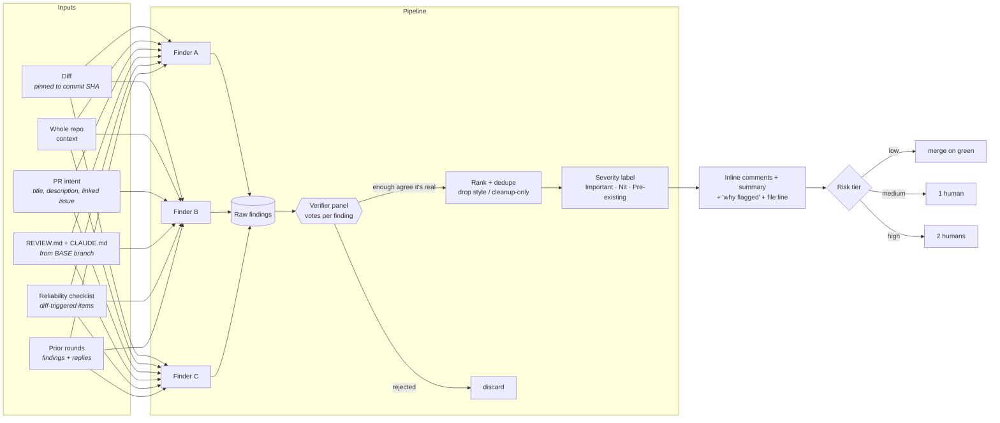
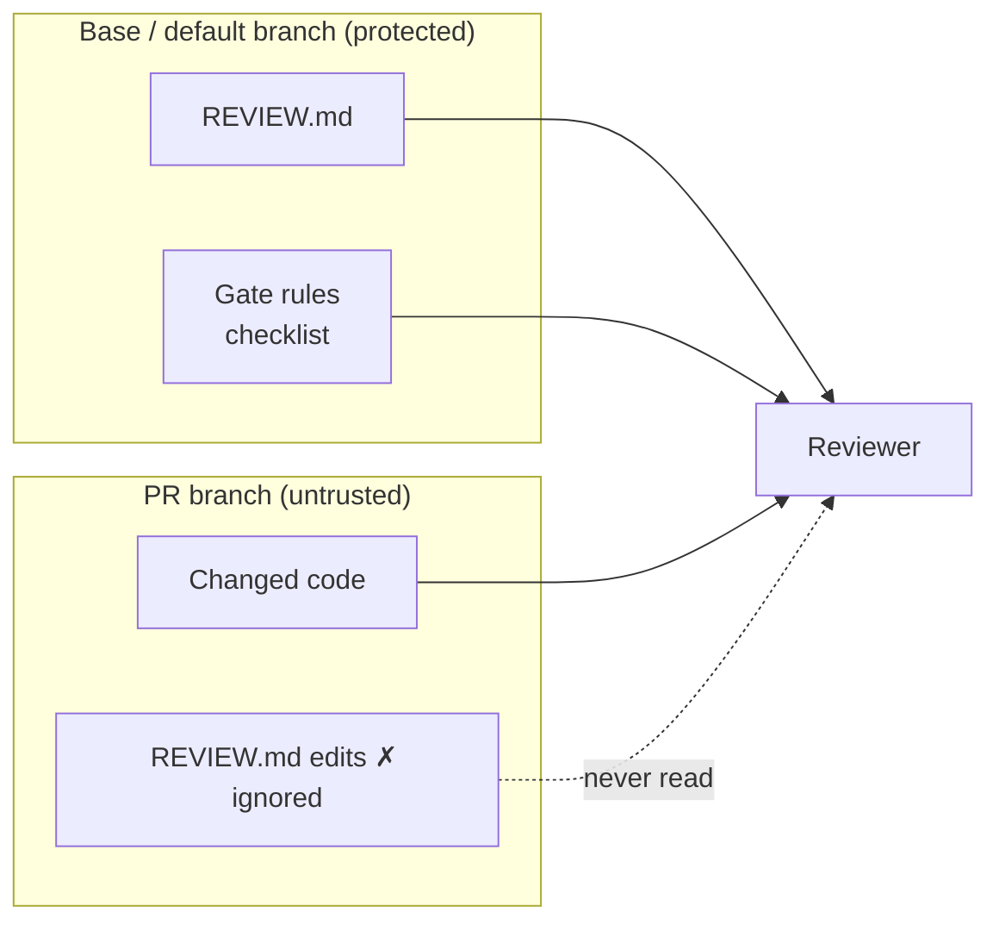

# Module 3: Anatomy of a reviewer agent

**Time:** ~40 min · **Prev:** [Module 2](02-verification-stack.md) · **Next:** [Module 4: What the reviewer must catch](04-reviewer-concerns.md)

## The big idea

A good reviewer agent is **a pipeline, not a prompt**. It finds broadly, verifies skeptically, ranks ruthlessly, and posts evidence that a person can act on in seconds. It is also **structurally protected** from the changes it judges.

## The reference architecture

This is based on Anthropic's Code Review pipeline (Find → Verify → Rank → Post), with the inputs and the integrity rules from the anchor post added.



### Stage by stage

| Stage | Job | Design notes |
|---|---|---|
| **Find** | Generate candidate bugs in parallel | Optimise for **recall**. Give finders different lenses (logic, data and compat, security, intent mismatch) or different checklist items. |
| **Verify** | Try to disprove each candidate | Optimise for **precision**. Use separate agents with fresh context, each voting real or not real. Post only if "enough of them agree." The threshold isn't published, so you tune it (Module 7). |
| **Rank & dedupe** | Merge duplicates, sort by severity, drop style, diagnostics and cleanup-only findings | Anthropic A/B-tested these filters on its own PRs before keeping them. |
| **Label** | Important / Nit / Pre-existing | Pre-existing keeps old bugs from being blamed on the author. |
| **Post** | Inline comment, summary, "why this was flagged," `file:line` | Every finding must be **answered**: fixed, or resolved with a reason. |

## The finding: the reviewer's unit of output

Design the schema before the prompt. Everything in Modules 6 and 7 measures this object.

```yaml
finding:
  id: f-0193
  commit_sha: 9c1e2ab          # findings are pinned to a commit
  file: src/session/store.ts
  line: 142
  severity: important          # important | nit | pre_existing
  category: backward-compat    # your taxonomy (Module 4)
  claim: >
    New required field `toolVersion` is read without a default; transcripts
    written before this PR will throw on --resume.
  evidence:
    - "store.ts:142 reads msg.toolVersion.major with no null check"
    - "Old fixture tests/fixtures/v3-transcript.json lacks the field"
  trigger: checklist:resume-loads-old-transcripts   # what caused the check
  why_human: null              # set when escalating: say WHY a person is needed
  verifier_votes: {real: 3, not_real: 0}
  suggested_fix: "Default to {major:0} when absent; add fixture test."
```

Why each field matters:

- `commit_sha`: "Reviews are tied to commits. If someone pushes during a review, the result is no longer useful."
- `evidence`: the docs suggest REVIEW.md can **require** a `file:line` citation. Findings without evidence are a common source of noise.
- `trigger`: lets you trace recall back to a checklist item or rule (Module 8).
- `why_human`: "When a check pulls in a reviewer, it should say why, so the reviewer doesn't have to work it out from the diff."

## Integrity rules (non-negotiable)

> "If a change can modify the check that judges it, the check is broken."



1. **Read config from the base branch.** Code Review reads REVIEW.md "from the pull request's base branch or from the default branch, never from the pull request's own changes."
2. **Protect the default branch.** On an unprotected branch the service reads only the root file. If protection can't be confirmed, it reads neither.
3. **Pin to a commit.** Results apply to one SHA, and approvals cover one commit.
4. **An agent's approval never counts as a human's.** The person directing the agent counts as a required reviewer.
5. **The tier is set by the change, not the author.** A classifier sets the risk tier from the change, and only trusted authors get the lighter paths.

**Why this matters more with AI authors:** an agent optimising to get a PR merged will, sooner or later, "fix" the check rather than the code: delete an assertion, loosen a rule, add a skip. Make that structurally impossible rather than relying on the agent's good behaviour.

## Convergence: one reviewer, many rounds

Two findings from the posts run against intuition:

1. **Don't stack reviewers.** Adding a second, more expensive reviewer on top of the first is "often a worse approach than tuning the primary." Tune the one you have through REVIEW.md.
2. **Rounds should build on each other.** Each pass gets earlier findings and past failures as context, which is "cheaper and finds more."

The convergence rules from the companion post:

- After **three rounds**, the reviewer asks the author to step back and reconsider the approach.
- After the first few passes, re-review **only the diff since the last review**.
- Flag the **bug class**, not one line, so the author fixes every instance at once.
- **Never repeat** a finding that has already been posted.

The team found that **~59%** of what the reviewer kept flagging in later rounds was code that had been there since its first pass. That is wasted rounds.

Their reported results on internal PRs:

| Metric | Before | After |
|---|---|---|
| Pass after one review+fix round | 65% | 78% |
| Needed 5+ rounds | 8.9% | 1.5% |
| Mean reviews to pass | 2.08 | 1.32 |

**Noise costs more when the author is an agent.** Every nit means another commit and another round. A nit a human would ignore, an agent will dutifully "fix."

## A starter REVIEW.md

```markdown
# REVIEW.md: read by the reviewer from the default branch

## What "Important" means here
- Data loss, corruption, or unreadable persisted data (incl. old transcripts/configs)
- Security: authz bypass, secrets in logs, injection, unsafe deserialisation
- Behaviour that contradicts the PR description or linked issue
- Breaking public API / CLI flags without a migration note

## Always check (diff-triggered)
- If `src/session/**` or message types change → can older transcripts still load?
- If a migration is added → is it idempotent? Is there a down path?
- If logging changes → no user content or tokens logged.

## Do not flag
- Formatting, import order, naming preferences (linters own these)
- Missing tests for pure refactors with unchanged behaviour
- Anything under `generated/`, `vendor/`, `**/fixtures/**`

## Output rules
- Every finding cites `file:line` and quotes the offending code.
- Report at most 5 Nits per review.
- Mark bugs the PR didn't introduce as Pre-existing.
- On re-review, don't repeat earlier findings; review only the new diff.
```

## A reviewer prompt skeleton (if you build your own)

```text
ROLE  You are the code reviewer for <repo>. You read; you do not run code.
GOAL  Find defects that would cause a revert or incident. Precision matters:
      every non-bug you post costs an author a round.
INPUT diff@<sha>, PR intent, REVIEW.md (base), triggered checklist items,
      prior findings + author replies.
STEPS 1. Restate the PR's intent in one sentence. Flag mismatch with the diff.
      2. For each triggered checklist item, run its check.
      3. Hunt for defects using the lenses in REVIEW.md.
      4. For each candidate, try to DISPROVE it. Keep it only if you can cite
         file:line evidence and explain the failure scenario.
      5. Label severity. Drop style. Mark pre-existing.
OUTPUT JSON list of findings matching the schema. Empty list is a valid answer.
```

Step 4 is a one-agent stand-in for the verifier panel. In production, split it into separate verifier agents with fresh context.

## Key takeaways

- The architecture is Find (recall) → Verify (precision) → Rank → Label → Post.
- Design the **finding schema** first, because evaluation and calibration measure it.
- Integrity: config from the base branch, results pinned to a commit, and no change can edit its own judge.
- One tuned reviewer with memory across rounds beats a stack of stateless reviewers.

---

## Exercises

**3.1 Find the integrity hole.** Your reviewer reads `.reviewer/rules.yaml` from the checked-out PR head. What can go wrong? How do you fix it?

<details><summary>Answer</summary>

An agent, or a person, can edit `rules.yaml` in the same PR to drop the rule the PR breaks. The judge is then modifiable by the change it judges. Fix: read rules from the base or default branch, protect that branch, and treat edits to rule files as their own high-risk change that needs human approval.
</details>

**3.2 Schema critique.** A teammate's finding schema is `{file, comment}`. Name four fields you'd add and the metric each one enables.

<details><summary>Answer</summary>

- `severity` → precision per severity; nit caps.
- `commit_sha` → staleness detection; pinning results to a commit.
- `evidence` (file:line plus quote) → verifiability; lets you measure unsupported-claim rate.
- `trigger` / `category` → recall per rule or category; pruning unused rules (Module 8).
- `verifier_votes` → threshold tuning (Module 7).
- `author_response` (filled in later) → noise taxonomy (Module 6).
</details>

**3.3 Convergence.** A PR has had 4 review rounds. Round 4 flags 3 new issues in code unchanged since round 1. Which two rules were broken?

<details><summary>Answer</summary>

(a) **Diff-only re-review** after the first passes: unchanged code should not be re-litigated. (b) **The round cap**: after three rounds the reviewer should ask the author to step back and reconsider the approach. There's arguably a third: flag the bug class in round 1, so later instances aren't drip-fed.
</details>

**3.4 Build it.** Write a REVIEW.md for a repo you know. Keep it under 40 lines. Include at least one diff-triggered rule that comes from a real past incident.
