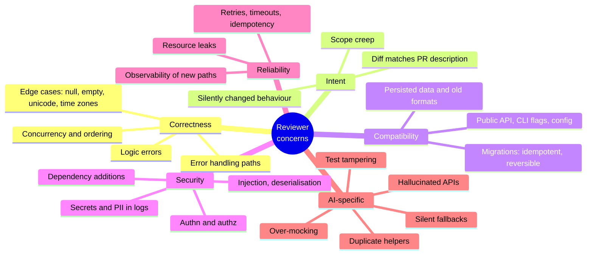
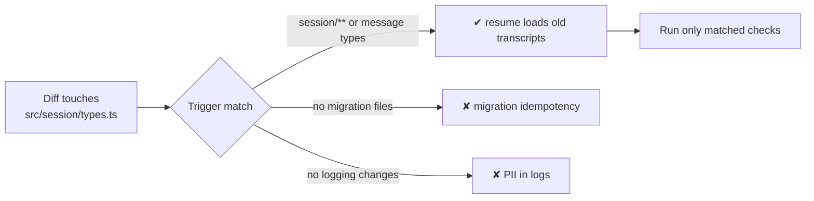
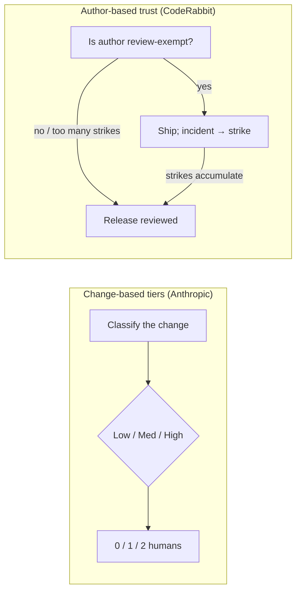

# Module 4: What the reviewer must catch (and what it must ignore)

**Time:** ~30 min · **Prev:** [Module 3](03-reviewer-anatomy.md) · **Next:** [Module 5: Where Quality Engineering fits](05-quality-engineering.md)

## The big idea

The reviewer's scope is defined by **what causes reverts and incidents in *your* codebase**, not by a generic checklist. By default, Anthropic's Code Review "focuses on correctness" and does not flag formatting or missing test coverage unless your guidance files say to.

A focused reviewer is useful. A reviewer that comments on everything gets ignored.

## The concern map



## Team-specific concerns: the reliability checklist

Anthropic keeps a **39-item reliability checklist**. Each item has:

1. a **trigger** that can be read from a diff,
2. a **check** to run,
3. the **incidents or PRs** that motivated it.

Example: *"--resume loads old transcripts."* When session storage or message types change, ask whether a new field loads safely in older transcripts.

The reviewer reads the diff and runs **only the items whose triggers match, "usually 3 to 10."** Running all 39 on every PR would cost more, make more noise and dilute attention.



Template for one item:

```yaml
- id: resume-loads-old-transcripts
  trigger: "diff touches src/session/** OR adds/changes a field on Message*"
  check: "Is the new field optional with a default? Is there an old-format fixture test?"
  origin: ["INC-2291", "PR #4410 revert"]
  severity_if_violated: important
  owner: "@session-team"
```

## AI-specific failure modes

Agent-written code fails in recognisable ways. These come up often in practice. Add the ones you actually see to your checklist.

| Failure mode | What it looks like | Why agents do it |
|---|---|---|
| **Test tampering** | Assertion deleted or loosened, `skip`, snapshot updated to match the bug | Optimising for "tests pass" |
| **Unit-green, feature-red** | Unit tests pass, but the user flow is broken | "Both the agent and the test don't understand the full task" |
| **Hallucinated API** | Calls a method or flag that doesn't exist in this version | Pattern-matched from other codebases |
| **Silent fallback** | `catch {}` returns a default; errors vanish | Avoiding a failing path |
| **Over-mocking** | The test mocks the thing under test | Making a test pass in isolation |
| **Duplicate helper** | Re-implements a utility that already exists | No search of the repo |
| **Scope creep** | Unrelated refactors bundled into the PR | Being "helpful" |
| **Intent drift** | Solves a nearby problem, not the one in the issue | Misreading the task |
| **Flaky-test workaround** | `sleep`, retries, `@flaky` | The anchor post explicitly bans these |

## What the reviewer should ignore

| Ignore | Because |
|---|---|
| Formatting, import order, naming taste | Linters and formatters own these, more cheaply and deterministically |
| "Consider adding a comment" | Low value. With an agent author it triggers another round |
| Missing tests for behaviour-preserving refactors | Not a defect; the eval would count it as noise |
| Generated, vendored and fixture paths | Not authored code |
| Hypotheticals without a failure scenario | Not verifiable, so the verifier panel should reject them |

## Severity: three labels, one job each

| Label | Meaning (from the docs) | Blocks? | Author owns it? |
|---|---|---|---|
| 🔴 **Important** | "A bug that should be fixed before merging" | Should | Yes |
| 🟡 **Nit** | "A minor issue, worth fixing but not blocking" | No; cap the count | Optional |
| 🟣 **Pre-existing** | "A bug that exists in the codebase but wasn't introduced by this PR" | No | **No** |

Pre-existing is easy to overlook and it matters. Without it, a reviewer that reads the whole repo will blame authors for old bugs, and authors will stop trusting it.

## Risk tiers: the reviewer decides who else looks

| Tier | Examples | Humans required |
|---|---|---|
| Low | Docs, copy, flagged additive changes | 0, once automated and security checks are green |
| Medium | Ordinary product changes; sensitive areas like caching, the auto-updater, system prompts | 1 |
| High | Highest-risk code plus a small set of always-two-people paths (e.g. billing, CI workflows) | 2 |

A classifier sets the tier **from the change, not the author**. A second classifier can require a person anyway.

### Contrast: author trust with accountability (CodeRabbit)

The [Pragmatic Engineer episode](https://newsletter.pragmaticengineer.com/p/software-factories-and-code-reviews) describes a different model:

- **The PR becomes the planning gate.** Agents, designers, support tickets and background agents (for example, Datadog opening PRs from alerts) now produce code without going through planning first. The human's first question about a PR is "**is this something I need to ship? Is it slop I need to close?**" The second is "**what's the risk?**" For example: is it a database migration, and why? Look at schema changes.
- **Review releases, not PRs.** For SOC 2, "the definition of change at CodeRabbit is now a release." CodeRabbit ships every 30–45 minutes. A Slack message summarises each PR in a release with risk indicators (minimal or high), and an engineer, not a PM, approves the release or rolls parts of it back. Rollback takes 10–15 minutes. Some PRs are fast-tracked, and "we are even letting our interns ship directly to production."
- **A "driving license."** Engineers on a **review-exempt list**, chosen by experience and past performance, ship without human review. When a fix lands, CodeRabbit **traces the regression back to the PR that introduced it** and measures how long bad code was **exposed** in production (for example, "100 hours of exposure" until a customer noticed). With enough strikes the license is taken away: the engineer's changes go through code review, then a **proving period**, before they can ship alone again.
- **What gets penalised is careless steering.** Engineers who question the AI about its implementation do well. Engineers who give a vague goal ("just solve this problem for me") end up with AI that "will completely re-architect it."

Orosz likes the model and compares it to old practice: interns used to need two sign-offs. His worry is that quality "seems to have dipped across the industry" because there is more change and less review.



| | Change-based tiers | Author trust + strikes |
|---|---|---|
| Decides review by | What the diff touches | Who shipped it, and their track record |
| Catches risk **before** prod | ✅ High-risk paths always get humans | ❌ Relies on the downstream verification layers |
| Overhead on trusted people | Some | Very low |
| Feedback signal | Reverts, incidents → new rules | Regression traced to PR → exposure time → strike on a person |
| Unit of human review | Risky PRs | Releases (batch of PRs with risk indicators) |
| Fits when | Many authors are agents; risk is concentrated in known paths | Small senior team; strong rollout and rollback |

These aren't mutually exclusive. Anthropic also gives lighter paths "only [to] trusted authors." A practical hybrid: tier by change, and let the author's track record move a PR **down** one tier, but never out of the always-two-people paths.

## Key takeaways

- Define scope from your own revert and incident history, encoded as diff-triggered checklist items.
- Run only the triggered items, typically 3–10 per PR.
- Look for AI-specific failure modes, especially test tampering and silent fallbacks.
- Ignore what linters own. Use Pre-existing so authors aren't blamed for old bugs.

---

## Exercises

**4.1 Triage drill.** Label each finding Important, Nit, Pre-existing or Drop. Then try the **Severity triage** tab in the [interactive lab](../lab/reviewer-lab.html), which has 12 more.

1. "`retryPayment()` is called inside a loop with no idempotency key; double charges possible." (new code)
2. "Variable `tmp` could have a more descriptive name."
3. "`parseDate()` in `utils/time.ts` (untouched by this PR) mishandles DST."
4. "This test's `expect(result).toEqual(42)` was changed to `expect(result).toBeDefined()`."
5. "Consider extracting this 6-line block into a helper."
6. "PR says 'add CSV export'; diff also rewrites the auth middleware."

<details><summary>Answer</summary>

1. **Important.** Reliability/idempotency, with a concrete failure scenario.
2. **Drop.** Naming taste; linter or human territory.
3. **Pre-existing.** A real bug, but not introduced here.
4. **Important.** Test tampering: an assertion was weakened to pass.
5. **Nit**, or Drop if your REVIEW.md caps nits or bans refactor suggestions.
6. **Important.** Intent mismatch / scope creep in a high-risk area. Should also raise the risk tier.
</details>

**4.2 Write a checklist item.** Pick a real incident from your team. Write it in the YAML template above. Is the trigger readable from a diff alone? If not, rewrite it until it is.

<details><summary>Hint</summary>

Bad trigger: "when the change affects performance." Good trigger: "diff adds a DB query inside a loop, or touches `**/repositories/**` without touching `**/indexes/**`." The test is whether a reviewer can decide match or no match *without running anything*.
</details>

**4.3 Pick a review model.** For each team, choose change-based tiers, author trust with strikes, or a hybrid, and give one reason.
1. 12 senior engineers, one service, solid feature flags and rollback, few agents.
2. 150 engineers, payments plus regulated data, most PRs written by agents.
3. A 30-person startup moving to heavy agent use, with weak rollout tooling.

<details><summary>Answer</summary>

1. **Author trust with strikes** is viable. Small, senior team, and strong rollout and rollback catch what review skips.
2. **Change-based tiers.** Agents don't build a track record you can strike. Regulated paths need humans *before* prod whoever wrote the change.
3. **Change-based tiers for now.** Strikes only work if outages are cheap and caught fast, and weak rollout tooling means they aren't. Invest in rollout tooling, then consider a hybrid.
</details>

**4.4 Scope debate.** Your security lead wants the reviewer to flag every missing input validation, everywhere. What does it cost, and what would you propose?

<details><summary>Answer</summary>

Cost: a flood of findings, many pre-existing or low-risk. Precision falls, authors learn to ignore the reviewer, and agent authors spend rounds on them. Proposal: (a) flag missing validation only on **new or changed** entry points, triggered by diff paths like `routes/**`; (b) label existing gaps Pre-existing and summarise them in one comment, or send them to a separate scheduled audit; (c) run in **observe mode** first (Module 7) to measure precision before turning it on.
</details>
