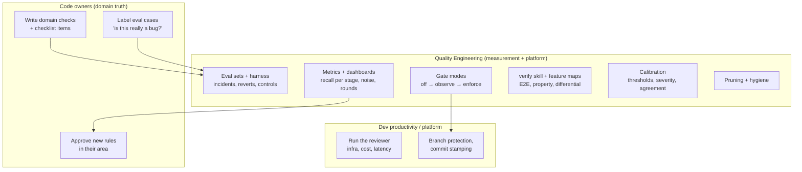
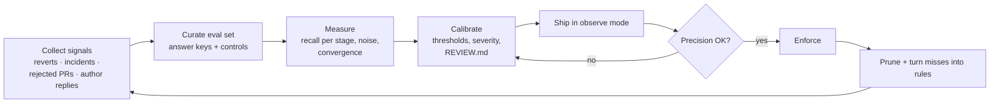

# Module 5: Where Quality Engineering fits

**Time:** ~30 min · **Prev:** [Module 4](04-reviewer-concerns.md) · **Next:** [Module 6: Evaluating the reviewer](06-evaluation.md)

## The big idea

When agents write the code and review it, Quality Engineering stops being "the people who test" and becomes **the people who make sure the checks can be trusted**. QE owns the *measurement system*: eval sets, gate modes, feature maps, the reliability checklist, and the metrics that say whether the reviewer is helping.

One way to put it: **QE is the reviewer's reviewer.**

## Why QE matters more now, not less

Three reasons, all drawn from the sources:

1. **The auditor can't be the creator.** If the same model with the same blind spots writes the code, the tests and the review, errors pass through every layer together. Property tests help because their inputs aren't "generated with the same bias as the agent that wrote the code." Building in that kind of independence is a QE skill.
2. **Old QE practices are now affordable.** O'Reilly's piece argues that AI makes decades-old QE techniques (requirements tracing, risk-based testing, structured inspection) cheap enough to run on every change. The anchor post makes the same point: checks are cheap to write and run.
3. **Someone has to own "is the reviewer right?"** The anchor post spends a whole section on *testing the reviewers*. That is a QE job.

## Code owners vs QE: who owns what

The anchor post says **code owners write their own checks**, refining them "until they flag what the owner would flag." QE doesn't take that over. QE provides the platform, the method and the measurement.

### RACI for reviewer-agent work

R = Responsible · A = Accountable · C = Consulted · I = Informed

| Activity | Code owner | QE | Platform | Eng lead |
|---|---|---|---|---|
| Write domain checklist items / REVIEW.md rules | **R** | C | – | A |
| Build and maintain the eval set | C (labels) | **R/A** | – | I |
| Run the eval on every prompt/model change | I | **R/A** | C | I |
| Choose verifier threshold and severity calibration | C | **R/A** | – | C |
| Move a gate from observe to enforce | C | **R** | C | **A** |
| Reviewer infra, cost, latency | – | C | **R/A** | I |
| Turn misses into rules | **R** (approve) | **R** (extract) | – | I |
| Prune stale rules and tests | C | **R/A** | – | I |
| Report the guardrail (reverts, incidents) | I | **R** | C | **A** |

## The QE operating loop

## The QE skill shift

| Traditional QE | QE for AI-generated code |
|---|---|
| Writes test cases | Designs **properties, feature maps and oracles** that agents generate tests from |
| Runs regression suites | Owns the **`verify` skill**, keeping it fast and reliable |
| Files bugs | Turns bugs into **diff-triggered rules** and **eval cases** |
| Signs off releases | Owns **gate modes** and the **evidence standard** for each risk tier |
| Measures test coverage | Measures **reviewer recall, precision, rounds-to-converge, revert rate** |
| Manual exploratory testing | Directs **agent-driven exploratory testing** (Chrome, mobile MCP, computer use) and reviews the evidence |
| Fights flaky tests | Enforces the **flaky-test policy**: no sleeps, no retry-until-green; delete and document |

## The evidence standard: QE's most useful deliverable

People now review **evidence**, not diffs. QE should define what evidence each tier needs, so "approve" means the same thing for everyone.

| Tier | Required evidence before a human (or no human) approves |
|---|---|
| Low | CI green · reviewer has no open Important findings · commit stamped `verified-by` |
| Medium | Above + `verify` skill trace (screenshots/logs) · triggered checklist items listed with results |
| High | Above + E2E run of affected feature-map flows · differential or property results where applicable · rollback plan |

## Key takeaways

- QE owns the measurement system around the reviewer: eval sets, metrics, gates, calibration, pruning.
- Code owners own domain truth: what counts as a bug in their area.
- QE's most important design job is **independence**, so the auditor isn't the creator.
- Define an **evidence standard** per risk tier so approvals mean something.

---

## Exercises

**5.1 RACI gap.** Your company has a reviewer agent but no one is "R" for running the eval when the model is upgraded. What happens on the next model upgrade?

Answer

The upgrade ships untested. Recall or precision can shift silently, and different models flag differently. You find out from authors complaining about noise, or from a revert the old reviewer would have caught. The companion post's rule is that every change to prompts, tools or **model** is scored against the full eval set and kept only if the score goes up. Someone has to own that.

**5.2 Independence audit.** For each pair, is the auditor independent of the creator? How would you increase independence?
1. Agent writes code and unit tests in the same session.
2. Agent writes code; a property test with generated inputs checks it.
3. Agent writes code; the same model in a fresh context reviews it.
4. Agent writes code; a differential test against production traffic checks it.

Answer

1. **Low.** Same context, same misunderstanding. Add E2E from a feature map written *before* the code.
2. **Higher.** Inputs aren't biased by the author, though the *property* could still be wrong. Have the code owner write or approve properties.
3. **Medium.** Fresh context removes anchoring but not model blind spots. Use a verifier panel and ground it in an eval set.
4. **High.** Production behaviour is an external oracle. Watch the approved-differences list for rubber-stamping.

**5.3 Write your evidence standard.** Fill in the three-tier table for your team. Be concrete: name the artifact (screenshot, trace, log line), not "testing done."

**5.4 Pitch.** In five bullet points, write the pitch to your engineering lead for one QE engineer owning the reviewer's measurement system. Use the guardrail metric from Module 1.
