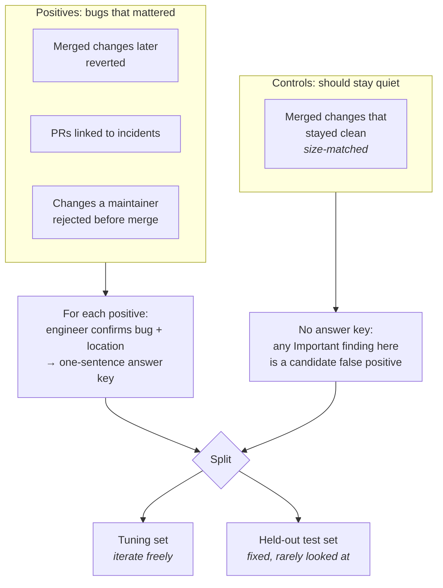
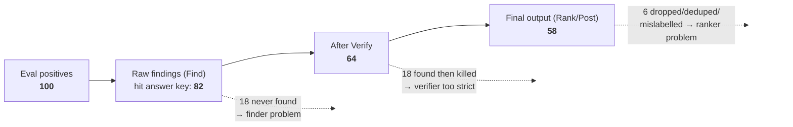
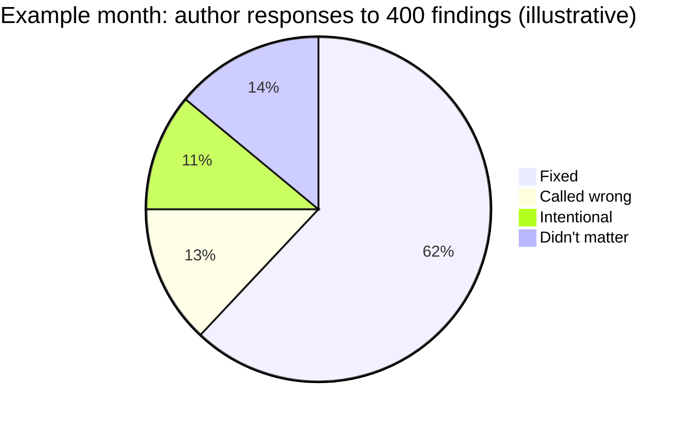

# Module 6: Evaluating the reviewer

**Time:** ~40 min · **Prev:** [Module 5](05-quality-engineering.md) · **Next:** [Module 7: Calibration](07-calibration.md) · **Lab:** [reviewer-lab.html](../lab/reviewer-lab.html)

## The big idea

You can't improve a reviewer you can't measure, and you can't measure it with vibes. Grade it **against bugs that actually mattered**: past incidents and reverts. Use **clean changes as controls**. Measure **recall at each stage**, not just end to end.

> Every AI code review vendor benchmarks itself, and wins. (Atlas review of 2026 benchmarks)

Independent 2026 benchmarks keep finding **low precision** for AI reviewers. One reports most tools near 25% on a large real-PR set. Older static-analysis guidance is still widely cited: Google's Tricorder kept an analyzer only while its false-positive rate stayed under **10%**, and above about **30%** people start ignoring a tool. Your own eval matters more than any vendor's number.

## Step 1: Build the eval set

Recipe from the two posts:

1. **Recreate the repo as it was at review time** for each case. The reviewer must not see the fix.
2. Have an engineer who knows the code **confirm the bug and where it lives**.
3. Write a **one-sentence answer key**, e.g. *"New `toolVersion` field read without default; old transcripts crash on resume."*
4. Add **size-matched clean changes** as controls. Without them, a reviewer that flags everything scores perfectly.
5. Keep a **tuning set separate from a fixed test set.**
6. **Run it daily**, and run it on *every* change to the prompt, tools or model. Keep a change only if the score improves.

### Scoring rule

> Only findings that correctly describe the bug in the answer key earn credit.

Flagging the right line for the wrong reason is a miss. Use a grader (an LLM judge plus spot-checks by people) that compares each finding against the answer key: *"Does this finding describe the same defect?"* Calibrate that grader as well (Module 7).

## Step 2: Measure recall at each stage

> A single end-to-end score hides whether the system loses bugs it had already found.

*(Illustrative numbers.)* End-to-end recall is 58%. The per-stage view shows the **verifier is losing as many real bugs as the finders miss**. Without it, you'd probably spend the next month tuning finders.

| Stage recall | Formula | If low, look at… |
|---|---|---|
| Find recall | answer-key hits in raw pool ÷ positives | Finder lenses, context (repo, checklist), model |
| Verify retention | hits after verify ÷ hits in raw pool | Vote threshold, verifier prompt, evidence requirement |
| Post retention | hits in final output ÷ hits after verify | Dedupe merging distinct bugs, severity mislabel, filters |

## Step 3: Measure noise (precision) two ways

### Offline: controls

Run on the clean controls. Count findings that **would lead to a harmful change** if the author acted on them. Anthropic measures exactly this. "Harmful" is a sharper bar than "wrong": a wrong nit is noise, while a wrong Important finding can push an agent author to break working code.

### Online: author responses

Tag every posted comment with how the author responded. This is the companion post's taxonomy:

| Author response | Counts as |
|---|---|
| **Fixed** | True positive (useful) |
| **Called wrong** | False positive |
| **Intentional** | False positive for this context. Often a missing REVIEW.md rule |
| **Didn't matter** | Low-value. Usually a severity calibration problem |

*Useful rate = 248/400 = 62%.* Track it **per severity** and **per category**. An Important false positive costs far more than a Nit false positive.

## Step 4: Measure convergence

From the companion post: % of PRs passing after one review-and-fix round, % needing 5+ rounds, mean reviews to pass. These measure the reviewer's cost to *authors*, which matters a lot when authors are agents paying per round.

## The full scorecard

| Metric | Source | Watch for |
|---|---|---|
| Recall per stage (find / verify / post) | Eval set | The biggest drop between stages |
| Harmful-FP rate on controls | Eval controls | Any rise after a change |
| Useful rate by severity | Author responses | Important < Nit means severity is inverted |
| Rounds to converge (mean, % ≥5) | PR history | Rising means noise or drip-fed findings |
| Revert rate, incidents | Prod | **The guardrail.** Must not rise |
| Human review time per PR | PR timeline | **The objective.** Should fall |

## When to stop tuning

> Tune recall up until the next gain would be overfitting the eval rather than catching bugs.

Signs you're overfitting: tuning-set score rises while held-out score stays flat; REVIEW.md rules that name specific eval cases; prompt changes that help one case and hurt three.

## Key takeaways

- Positives come from real reverts, incidents and rejections. Controls are size-matched clean merges.
- Answer keys plus "credit only for the correct description" make the scoring honest.
- Per-stage recall tells you **which** stage to fix.
- Measure noise offline (controls) and online (author responses), split by severity.
- Run the eval on every prompt, tool or model change, and keep a held-out set.

---

## Exercises

**6.1 Compute.** Eval: 120 positives, 120 controls.
- Raw findings matched 96 answer keys. After verification, 90. Final output, 72.
- On the controls the final output posted 30 Important findings, of which 18 would cause a harmful change.

Compute find recall, verify retention, post retention, end-to-end recall, and harmful-FP rate per control PR. Where do you look first?

Answer

- Find recall = 96/120 = **80%**
- Verify retention = 90/96 = **93.75%**
- Post retention = 72/90 = **80%**
- End-to-end = 72/120 = **60%**
- Harmful FP = 18/120 = **0.15 per control PR** (15%)

Look first at the **Rank/Post stage**: it loses 18 confirmed bugs, the same number the finders miss, and it's cheaper to fix. Likely causes: dedupe merging distinct bugs, filters dropping real bugs as "cleanup-only," or severity mislabelling them as dropped Nits. Separately, a 15% harmful-FP rate on controls is high. Look at what those 18 findings have in common.

**6.2 Design the eval.** You have 18 months of git history but no incident tags. How do you bootstrap positives?

Answer

- `git log --grep -i revert` and commits whose message starts with `Revert "`. Pair each with the original PR.
- Hotfix PRs merged within 72h of a deploy that touch the same files as a recent PR.
- PRs closed without merging after a "changes requested" review that named a bug.
- Have code owners confirm each one and write the one-sentence key. Aim for 50–100 confirmed cases before trusting any number. Then build matched controls: for each positive, a clean merged PR of similar size from the same area and time window.

**6.3 Interpret.** Useful rate is 70% for Nits and 45% for Important. What's wrong, and what do you change?

Answer

Severity is **inverted**: the reviewer is less reliable when it claims something matters most. Look at the "called wrong" and "intentional" Importants. Common fixes: require a concrete failure scenario and `file:line` evidence for Important; raise the verifier vote threshold **only for Important**; add REVIEW.md rules for the recurring "intentional" patterns. Re-run the eval to confirm recall on positives holds.

**6.4 Lab.** Open the **Threshold tuner** in the [lab](../lab/reviewer-lab.html). Find the vote threshold that maximises F1. Then find the one that keeps harmful FPs ≤ 1 while giving the most recall. Are they the same? Finally, check which threshold the default cost table picks.

Answer

- **F1 is highest at k = 3** (P 70%, R 70%, F1 0.70), but that still posts 5 harmful FPs.
- A single threshold reaches **harmful FPs ≤ 1 only at k = 5**, and recall falls to 30%.
- With the default costs (false Important 3, false Nit 0.5, miss 4), **k = 2** has the lowest cost. That's a third answer.
- Now tick **Separate threshold for Important**. Important at 5 with Nits at 1 keeps harmful FPs at 1 and lifts recall to 50%.

The lesson: "best" depends on what you optimise. F1, a safety constraint and a cost model each pick a different threshold, and per-severity thresholds beat any single one. Write down your objective *before* you tune.

