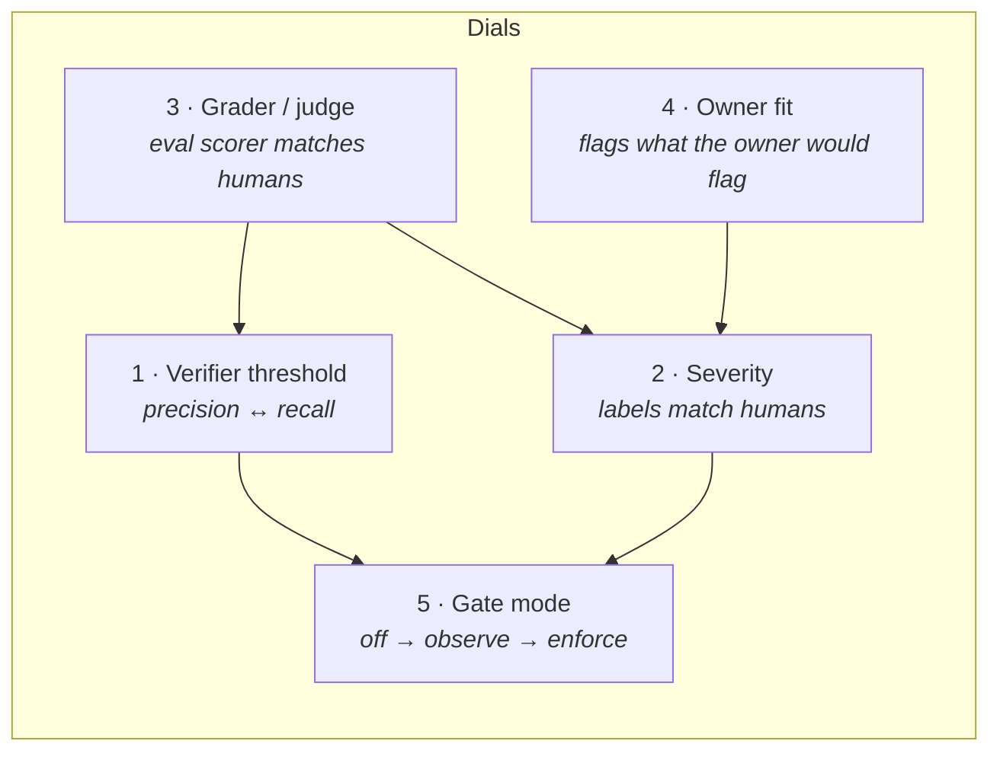
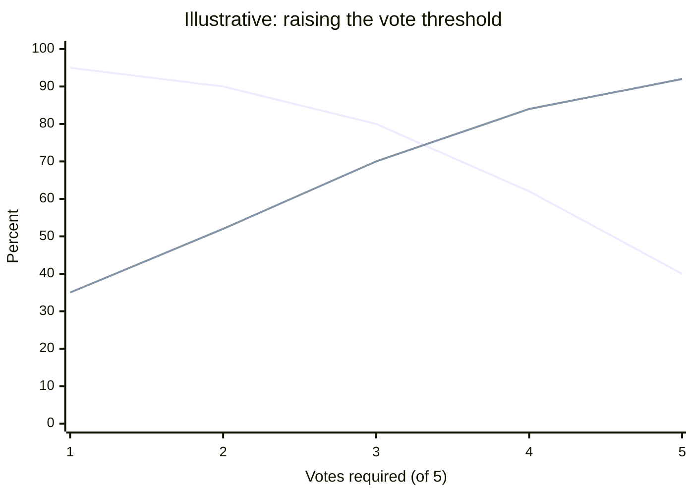
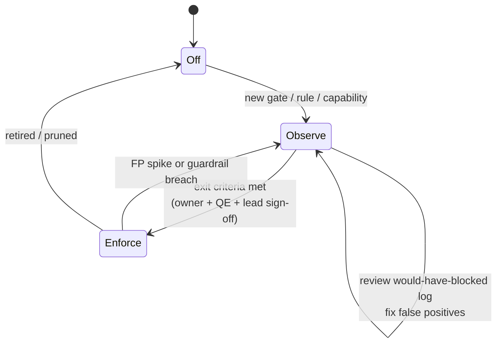

# Module 7: Calibration

**Time:** ~40 min · **Prev:** [Module 6](06-evaluation.md) · **Next:** [Module 8: Expanding the reviewer safely](08-expanding-the-reviewer.md) · **Lab:** [reviewer-lab.html](../lab/reviewer-lab.html)

## The big idea

Evaluation tells you **how good** the reviewer is. Calibration makes its outputs **mean what they say**: "Important" means important to *your* team, a blocked commit was worth blocking, and the grader that scores your eval agrees with your engineers.

There are five dials. Each has its own method.

**Calibrate the grader (D3) first.** If the judge scoring your eval is miscalibrated, every other dial is tuned against a wrong ruler.

## Dial 1: Verifier threshold

The verifier panel votes on each candidate, and a finding posts if enough voters agree it's real. Raising the bar trades recall for precision.

How to pick the threshold:

1. Decide the **cost ratio**. A false Important to an agent author costs a round and may cause a harmful "fix." A missed bug costs a revert or an incident. Write the ratio down, e.g. "one missed incident-class bug ≈ 20 false Nits ≈ 4 false Importants."
2. Set **separate thresholds per severity**. Important needs high precision. Nits can be looser because they're capped and non-blocking.
3. Choose on the **tuning set**, then confirm on the **held-out set**.
4. Re-check whenever the model, prompt or verifier count changes.

➡️ *Try it: **Threshold tuner** tab in the lab.*

## Dial 2: Severity calibration

The question: when the reviewer says Important, do your engineers agree?

Method:
1. Sample 100–200 posted findings, stratified by severity.
2. Two engineers label each one Important, Nit, Pre-existing or Not a bug, **blind to the reviewer's label**.
3. Measure **engineer–engineer agreement** first. That's the realistic ceiling.
4. Measure **reviewer–engineer agreement** and build a confusion matrix.
5. Fix the biggest off-diagonal cell. It is usually Nit labelled as Important, or Pre-existing labelled as Important.

Typical fixes: define "Important" concretely in REVIEW.md, require a failure scenario for Important, and give the reviewer `git blame` context so it can spot Pre-existing.

## Dial 3: Grader / judge calibration, with Cohen's kappa

Your eval uses an LLM judge to decide whether a finding matches the answer key. Calibrate it against human labels.

**Why kappa and not plain agreement?** If 90% of findings don't match, a judge that always says "no match" gets 90% agreement and is useless. Kappa corrects for chance:

$$\kappa = \frac{p_o - p_e}{1 - p_e}$$

- $p_o$ = observed agreement
- $p_e$ = agreement expected by chance, from each rater's label frequencies

### Worked example

Judge vs human on 100 finding-to-key pairs:

|  | Human: match | Human: no match | Total |
|---|---|---|---|
| **Judge: match** | 40 | 10 | 50 |
| **Judge: no match** | 5 | 45 | 50 |
| **Total** | 45 | 55 | 100 |

- $p_o = (40 + 45)/100 = 0.85$
- $p_e = (0.50 × 0.45) + (0.50 × 0.55) = 0.225 + 0.275 = 0.50$
- $\kappa = (0.85 − 0.50)/(1 − 0.50) = \mathbf{0.70}$

### Good practice (from the calibration literature)

- **Measure human–human agreement first.** A judge can't be more aligned than the labels it's checked against.
- **Report raw agreement and kappa together.** Use weighted kappa for ordered labels like severity.
- **Add uncertainty.** Bootstrap over cases, because small calibration sets are fragile.
- **No universal cutoff.** Set acceptance criteria by use case. As rough context, one healthcare review found LLM-vs-expert kappa ranged from 0.59 to 0.88.
- **Re-calibrate** whenever the judge model, prompt or task changes.
- **Pair kappa with error analysis.** Read the disagreements.

➡️ *Try it: **Agreement** tab in the lab.*

## Dial 4: Owner fit

> Code owners write checks and refine them until they flag what the owner would flag.

This is calibration done by hand, area by area. A practical loop for an owner:

1. Pull the last 20 PRs in their area.
2. Run the reviewer, or just their checklist items, in observe mode.
3. The owner marks each finding: *would I have flagged this?* Also note what they would have flagged that it missed.
4. Edit the area's REVIEW.md section or checklist trigger. Repeat until misses and extras are both rare.

When a check pulls in a human, it must say **why** (`why_human`), so the owner doesn't have to work it out from the diff.

## Dial 5: Gate mode, from observe to enforce

From the anchor post:

- **Off.** Nothing happens.
- **Observe** logs what *would have been* blocked, so false positives can be reviewed before anyone is affected.
- **Enforce** blocks the commit. The author can explain in the commit message why it wasn't verified.
- **Escape hatch:** after **two blocks in one session**, the next commit is allowed through, "so Claude doesn't get stuck – Claude Code isn't perfect." Escapes are logged and reviewed.
- Every commit is stamped with how it was verified, including "none," so you can query coverage.

### Example exit criteria for observe → enforce

*(Set your own numbers. These are a template.)*

| Criterion | Example bar |
|---|---|
| Observation window | ≥ 2 weeks and ≥ 200 would-be decisions |
| Would-have-blocked precision (human-reviewed sample) | ≥ 90% for blocking gates |
| Harmful FP on eval controls | No increase vs baseline |
| Held-out recall | ≥ baseline − 2 pts |
| Escape-hatch rate (projected) | < 5% of sessions |
| Sign-off | Area owner + QE + eng lead |

The precision bar for a *blocking* gate should be well above the ~70% that's tolerable for advisory comments. Recall the Tricorder lesson: above ~10% false positives, people stop trusting a tool.

## Key takeaways

- Calibrate the **grader** first, then threshold and severity, then gates.
- Use **kappa** with raw agreement, and compare against human–human agreement.
- Use **per-severity thresholds**: high precision for Important, looser for capped Nits.
- **Always observe before you enforce**, with written exit criteria and an escape hatch.

---

## Exercises

**7.1 Compute kappa.** Reviewer vs engineer on "is this a real bug?" (n = 80):

|  | Eng: real | Eng: not real |
|---|---|---|
| **Reviewer: real** | 50 | 14 |
| **Reviewer: not real** | 6 | 10 |

Answer

- $p_o = (50 + 10)/80 = 0.75$
- Reviewer "real" = 64/80 = 0.8; Eng "real" = 56/80 = 0.7
- $p_e = 0.8×0.7 + 0.2×0.3 = 0.56 + 0.06 = 0.62$
- $\kappa = (0.75 − 0.62)/(1 − 0.62) = 0.13/0.38 ≈$ **0.34**

Raw agreement of 75% looks fine, but kappa is weak. The reviewer says "real" too often (80% vs 70%), and most of its agreement comes from the high base rate. Look at the 14 false "real" calls.

**7.2 Pick the threshold.** Using the illustrative chart above, suppose a false Important costs 1 unit and a missed bug costs 3 units. Assume 100 real bugs and that posted findings = recall×100 / precision. Which threshold minimises cost?

Answer

FPs = posted − TPs = recall×100×(1/precision − 1). Misses = 100 − recall×100.

| k | TPs | FPs ≈ | Misses | Cost = FP + 3×miss |
|---|---|---|---|---|
| 1 | 95 | 176 | 5 | 191 |
| 2 | 90 | 83 | 10 | 113 |
| 3 | 80 | 34 | 20 | **94** |
| 4 | 62 | 12 | 38 | 126 |
| 5 | 40 | 3 | 60 | 183 |

**k = 3.** If misses cost 10× instead, re-run it and k = 2 wins (cost 183 vs k=3's 234). The cost ratio drives the threshold, which is why you write it down.

**7.3 Exit criteria.** You want to enforce a new "no PII in logs" gate. Draft its observe-mode exit criteria and name who signs off.

**7.4 Lab.** In the **Agreement** tab, label the 12 sample findings yourself, then compare your kappa with the "second engineer." Is the judge worse than the humans, or are the humans the problem?

What to notice

Judge vs Engineer 2 has **67% raw agreement but κ = 0.33**. The judge calls 8 of 12 "real" and the engineer calls 6. Every disagreement but one is the judge saying "real" where the engineer says "not": the parameterised "SQL injection," the best-effort cache, the optional-field null. Those are context failures. The judge doesn't know the query is parameterised or the cache is best-effort. The fix is context and REVIEW.md rules, not a bigger model.

If your κ with Engineer 2 is also low, the **label definition** is ambiguous, not just the judge. Tighten the definition of "real bug" (for example, "would cause a revert or incident if merged") and re-label before you tune anything.

