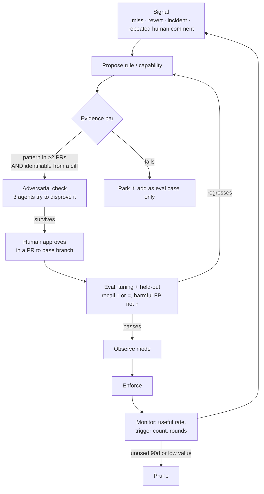
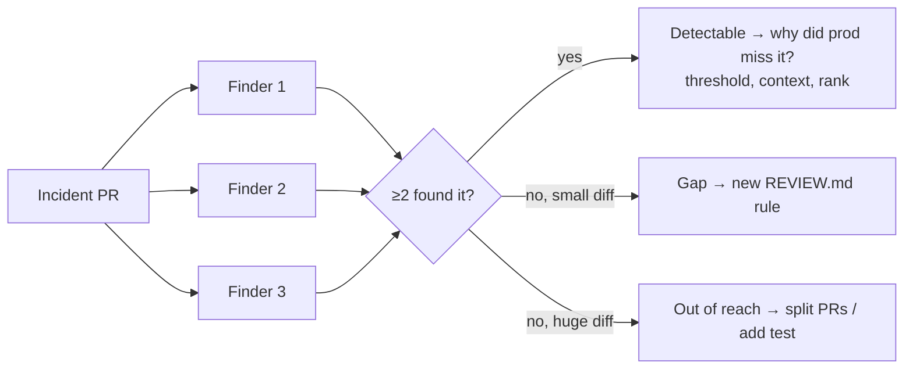

# Module 8: Expanding the reviewer safely

**Time:** ~30 min · **Prev:** [Module 7](07-calibration.md) · **Next:** [Module 9: Capstone](09-capstone.md)

## The big idea

Every expansion of the reviewer (a new rule, lens, language, model, tool, or the power to block or approve) is a **change to a production system that judges other production changes**. Treat it like one: evidence → adversarial check → eval with no regressions → observe → enforce → monitor → prune.

## What counts as an "expansion"

| Expansion | Example | Main risk |
|---|---|---|
| New REVIEW.md rule | "Flag DB queries inside loops" | Noise; overlaps with other rules |
| New checklist item | "Feature flags must default off" | Trigger too broad, so it fires on every PR |
| New finder lens | Dedicated security or concurrency finder | Recall gain, precision loss, cost |
| New scope | New repo, language, monorepo area | Domain rules don't carry over |
| Model or prompt change | Model upgrade | Silent shift in recall and precision |
| New tool access | Reviewer can run tests or read prod logs | Cost, latency, data exposure |
| New authority | Findings block merge; low-tier auto-approve | Mistakes now have real consequences |

## The expansion lifecycle



## Turning misses into rules: the two methods

Both are from the anchor post.

### Method 1: Mine human review comments and reverts

1. Extract candidate patterns from human review comments and reverts.
2. **Bar:** the pattern appears in **at least two PRs** and is **identifiable from a diff**.
3. **Three agents try to disprove it**: is it really a bug pattern, does it overlap an existing rule, would it fire on clean code?
4. **A human approves it in a PR.** The rule lands on the protected base branch like any other change.

### Method 2: Replay against known incidents

1. Take a PR linked to a known incident.
2. **Replay three bug finders** against it.
3. **If at least two find the bug**, it's detectable. The reviewer can catch this class, so look at why the production run didn't (threshold? context?).
4. **If it's missed on a small diff**, the gap becomes a **REVIEW.md rule**.



## The regression guard

Every expansion produces an **eval diff report** before merge:

```text
Reviewer change: add rule "db-query-in-loop"           base: v41 → candidate: v42
                         tuning   held-out
Find recall              81→84    78→80   ▲
Verify retention         92→92    91→90   ▼1 (within noise)
Post recall              70→73    66→68   ▲
Harmful FP / control PR  .08→.11  .07→.10 ▲ ✗ exceeds +.02 budget
Mean rounds (replay)     1.4→1.5
Cost per review          $0.41→$0.47
Verdict: BLOCKED. Rule fires on ORM batch loaders. Narrow trigger, re-run.
```

Things to notice: a **budget** for each metric, a **held-out** column, and cost tracked next to quality.

## Don't stack reviewers

The tempting expansion is "add a second, smarter reviewer on top." The anchor post says this is "often a worse approach than tuning the primary." A second reviewer means more noise, more rounds, conflicting findings, double the cost, and a second system to calibrate. Prefer:

- a better REVIEW.md,
- a new *finder lens* inside the same pipeline (one verifier panel, one ranker, one voice),
- memory across rounds.

## Granting authority: the highest-risk expansion

Moving the reviewer from **advisory** to **blocking**, or letting it **auto-approve** low-tier PRs, changes what its mistakes cost. Preconditions:

- Integrity rules are in place: base-branch config, protected branch, commit-pinned results (Module 3).
- The risk-tier classifier is evaluated on its own. A misclassified high-risk PR that skips humans is the worst failure.
- Observe mode has run with exit criteria met (Module 7).
- An agent's approval **never** counts as a human's.
- The escape hatch, its logging, and a rollback plan for the gate itself are in place.

In the public Code Review product, the check run "doesn't conclude as a failure" and doesn't approve or block by itself. Authority is configured separately, through a policy file. That separation is good design: **finding** and **deciding** are different powers.

## Pruning

> Test suites, verification steps, and .md files "only grow if you let them."

A pruning review, monthly or quarterly:

| Signal | Action |
|---|---|
| Rule or checklist item didn't trigger in 90 days | Retire, or check whether its trigger is broken |
| Rule's useful rate < 40% | Narrow the trigger or retire |
| Two rules flag the same findings | Merge |
| Test flaky with no root cause | Delete and document why (anchor post policy) |
| REVIEW.md > ~150 lines | Split by area into included files; drop stale rules |
| Eval case no longer reproducible (code deleted) | Archive it, keep a note |

## Fine-tune, or change context and config?

CodeRabbit **used to fine-tune its review models and stopped**: "the frontier was moving faster than we could maintain those fine-tuned [models]... the shelf life of those investments were very short." Gill says the effort now goes into "**fine-tuning the harness**": the right context, code graphs and semantic analysis, and routing each workload to a model ([Pragmatic Engineer episode](https://newsletter.pragmaticengineer.com/p/software-factories-and-code-reviews)). He adds that fine-tuning might still pay if you had a data stream the labs don't train on. Code isn't that.

That fits the Anthropic approach, where most expansion happens through **context and config** (REVIEW.md, checklist items, finder lenses), not model weights.

| Expansion lever | Survives a model upgrade? | Cost to change | Prefer when |
|---|---|---|---|
| REVIEW.md rule / checklist item | ✅ | Minutes | Almost always |
| Finder lens / prompt | Mostly. Re-run the eval | Hours | New category of concern |
| Tool access (run tests, read logs) | ✅ | Days | The reviewer needs facts it can't read from code |
| Model routing (which model for which stage) | ✅ Re-evaluate each slot | Hours | A new model is cheaper or better for one stage |
| Fine-tuned model | ❌ Redo it per base model | Weeks | Rarely. Only for a stable, narrow task with lots of labels the labs don't have |

Whatever you choose, a **model upgrade is an expansion** and goes through the eval diff report.

## Versioning

Treat reviewer config as a versioned product: a REVIEW.md changelog, an eval report per version, the model ID pinned in config, and the ability to roll back to v(n−1) in minutes.

## Key takeaways

- Every expansion goes through: evidence → adversarial check → eval with no regressions → observe → enforce → monitor → prune.
- Bar for a new rule: **≥2 PRs and identifiable from a diff**, three agents fail to disprove it, a human approves.
- Every change gets an eval diff report with **budgets**, including cost.
- Tune the primary reviewer. Don't stack a second one.
- Granting authority is its own expansion with its own preconditions.
- Prune on a schedule.

---

## Exercises

**8.1 Evidence bar.** A senior engineer wants a rule: "Flag any use of `any` in TypeScript." It appears in hundreds of PRs. Does it meet the bar? What would you do?

<details><summary>Answer</summary>

It's identifiable from a diff and appears in ≥2 PRs, but it isn't tied to reverts or incidents. It's a **style or lint** concern. A linter (`@typescript-eslint/no-explicit-any`) does it deterministically and cheaply. Don't put it in the reviewer. If `any` has caused real bugs in specific places, like API boundaries, write a narrow rule: "`any` on exported types in `api/**`."
</details>

**8.2 Read the eval report.** A model upgrade gives: held-out post recall +6, harmful FP per control −0.01, mean rounds +0.4, cost +35%. Ship it?

<details><summary>Answer</summary>

Quality improved on both axes, but rounds rose 0.4. Check where: the new model may be drip-feeding findings across rounds, or flagging the class line by line. With agent authors, rounds cost real money and latency. Probably **ship to observe**, look at the round-inflation cases, adjust the prompt (flag bug class, no repeats), then enforce. Check the +35% cost against the value of the recall gain.
</details>

**8.3 Replay.** You replay three finders on an incident PR (40-line diff). One of three finds the bug. What's the classification and the next step?

<details><summary>Answer</summary>

Fewer than two found it, so it's **not reliably detectable**, and the diff is small. It's a **gap**, so write a REVIEW.md rule (or checklist item with a diff trigger) describing the bug class. Then add the incident to the eval set, re-run the replay, and expect ≥2 of 3 to find it.
</details>

**8.4 Design.** Write the lifecycle plan (evidence, adversarial check, eval budgets, observe criteria, owner) for adding a **concurrency finder lens** to your reviewer.
