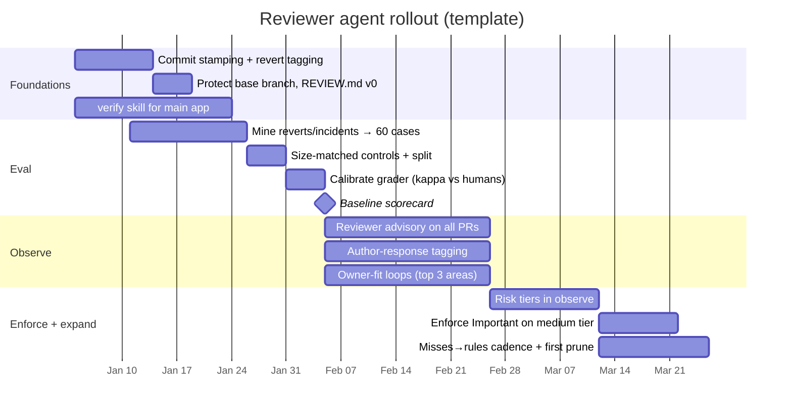

# Module 9: Capstone — your rollout plan

**Time:** ~60 min · **Prev:** [Module 8](08-expanding-the-reviewer.md) · **Back to:** [README](../README.md)

## The brief

Write the plan to roll out (or fix) an AI reviewer agent for a team you know. At the end you should have five artifacts:

1. A **90-day plan**
2. A **REVIEW.md** (≤ 40 lines)
3. A **reliability checklist** with ≥ 5 diff-triggered items from real history
4. An **eval design** (positives, controls, split, scorer)
5. A **scorecard**, with objective, guardrail and budgets

## Reference 90-day plan

## Scorecard template

| Metric | Baseline | Target @90d | Budget / tripwire | Owner |
|---|---|---|---|---|
| Human review min / merged PR (median) | | ↓ 30% | – | Eng lead |
| Revert rate (7-day) | | ≤ baseline | Breach → back to observe | QE |
| Sev2+ incidents / 100 PRs | | ≤ baseline | Breach → back to observe | QE |
| Held-out post recall | | ≥ 65% | −2 pts per change | QE |
| Harmful FP / control PR | | ≤ 0.10 | +0.02 per change | QE |
| Useful rate, Important | | ≥ 70% | < 60% → re-calibrate | QE + owners |
| % PRs pass after 1 round | | ≥ 75% | – | QE |
| % commits stamped "none" | | ≤ 10% | – | Platform |
| Cost / review | | – | +25% needs sign-off | Platform |

## Self-assessment

Score 0 (no), 1 (partly) or 2 (yes). Under 14 means read the linked module again.

| # | I can… | Module |
|---|---|---|
| 1 | State my team's objective **and** guardrail metric | 1 |
| 2 | Explain why the reviewer doesn't replace tests or `verify` | 2 |
| 3 | Draw Find → Verify → Rank → Post and say what each optimises | 3 |
| 4 | Name the five integrity rules | 3 |
| 5 | Write a diff-triggered checklist item from a real incident | 4 |
| 6 | Name five AI-specific failure modes | 4 |
| 7 | Split ownership between code owners and QE | 5 |
| 8 | Build an eval set with answer keys and controls | 6 |
| 9 | Compute recall per stage and say which stage to fix | 6 |
| 10 | Compute and interpret Cohen's kappa | 7 |
| 11 | Write observe → enforce exit criteria | 7 |
| 12 | Run a rule through the expansion lifecycle | 8 |

## Common pitfalls (pre-mortem)

Imagine it's day 90 and the rollout failed. The likely reasons:

- **No guardrail data.** Reverts weren't tagged, so nobody could prove the reviewer wasn't making things worse.
- **Enforced on day 1.** False positives blocked agents, people found workarounds, and trust fell.
- **Stacked reviewers.** Two bots with conflicting findings doubled the rounds.
- **The judge was never calibrated.** The eval looked great, then reality didn't.
- **REVIEW.md grew to 400 lines.** Nothing was ever pruned.
- **The PR could edit the reviewer's config.** One agent "fixed" the rule instead of the code.
- **Nobody owned the model upgrade.** Recall shifted silently.

## Final exercise

Write the five artifacts. Then review your own plan with the reviewer mindset: for each artifact, write one finding labelled Important, Nit or Pre-existing. If you can't find an Important, ask a teammate to try.
